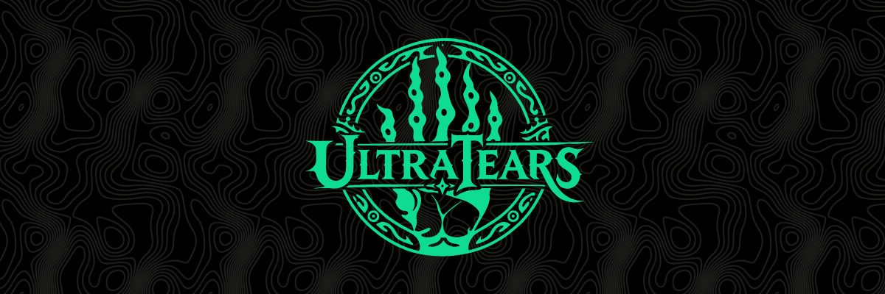

<p align="center"><b>English</b> · <a href="README.ru.md">Русский</a></p>

<p align="center"></p>

# UltraTears

**UltraTears** builds a native version of *The Legend of Zelda: Tears of the Kingdom* (version 1.4.3) for Windows, Linux
and the Steam Deck from your own copy of the game. It is not an emulator: the game's code is translated to native code
ahead of time, and its shaders and textures are prepared when the game is built, not while you play.

> [!IMPORTANT]
> **No game files are included.** You need your own copy of the game with update 1.4.3, dumped from your own console as
> plain `exefs` and `romfs` folders. This project provides no game files, keys, firmware or dumping tools, and
> UltraTears decrypts nothing. Everything made from the game is made on your PC, for your own use: do not share it.
>
> UltraTears is not affiliated with or endorsed by Nintendo. *The Legend of Zelda* and *Tears of the Kingdom* are
> trademarks of Nintendo.

Report problems on [Issues](https://github.com/kuraeow/ultratears/issues) with `ultratears.log` from the game folder.

## Installing

**You need:** Windows 10/11 or Linux (kernel 6.7+, glibc 2.34+; SteamOS 3 has both), a graphics card with a current
Vulkan 1.3 driver, 16 GB of RAM, 4 GB of video memory, about 40 GB free, and your dump:

```text
dump\
├── exefs\   main, subsdk0, sdk, main.npdm, ...
└── romfs\   about 304,000 files, 16 GB
```

### Windows

1. Download `UltraTears-<version>-windows-x86_64.zip` from [Releases](https://github.com/kuraeow/ultratears/releases)
   and extract it into its own folder.
2. Start `UltraTears Launcher.exe`. If SmartScreen warns about it, choose **More info → Run anyway**.
3. Choose the folder with `exefs` and `romfs` and click **Prepare the game**. It builds the game once, about 30 minutes.
4. Click **Play**.

To play on a Steam Deck, choose **For Linux (Steam Deck)** or **Both platforms** next to **Prepare the game**: you get
`UltraTears-SteamDeck.tar` (about 28 GB), which you extract on the Deck and start as below, from step 4.

### Linux and Steam Deck

1. Download `UltraTears.AppImage` from [Releases](https://github.com/kuraeow/ultratears/releases). On a
   Steam Deck, do this in Desktop Mode.
2. In the file's Properties, on the **Permissions** tab, turn on **Allow executing file as program**, then start it.
3. Choose the folder with `exefs` and `romfs` and click **Prepare the game**.
4. When the game is prepared, add `UltraTears.AppImage` from the game folder to Steam as a non-Steam game. With `--play`
   in its launch options it starts the game directly, without the launcher. Start the game from Gaming Mode.

The launcher finds new versions itself and rebuilds only what changed; saves in `userdata` are kept. On Linux you can
also put a newer `UltraTears.AppImage` into the game folder in place of the old one: the launcher then offers the update.

<details>
<summary>Controls</summary>

The controller's button layout follows the Switch (A is the right button).

Keyboard: WASD move, arrow keys camera, J = A, K / Space = B, I = X, U = Y, Q / E = L / R, Alt / Shift = ZL / ZR,
Enter = +, Tab / Esc = − (map), T F G H = d-pad, Z / C = stick buttons, F11 or Alt+Enter full screen. Mouse support is
planned.
</details>

<details>
<summary>Chinese and Korean text</summary>

For Simplified Chinese, Traditional Chinese and Korean the game uses the Switch's own system fonts. They are part of
the console's system software, not of the game, so the port can't make them from the dump. Without them the game stops
when it starts in one of these languages; all other languages don't need them.

Put the console's shared font files, taken from your own Switch, into `sysdata\fonts\` next to `exefs` and `romfs` in
your dump folder before **Prepare the game** (or later straight into `data\fonts\` in the game folder):

```text
dump\
└── sysdata\fonts\   0-standard.bfttf, 1-chinese-simplified.bfttf, 2-chinese-simplified-extension.bfttf,
                     3-chinese-traditional.bfttf, 4-korean.bfttf, 5-nintendo-extension.bfttf
```

Put in all six; the game reads only the ones it asks for.
</details>

## Building from source

Install Git and Python 3, then:

```powershell
git clone https://github.com/kuraeow/ultratears.git
cd ultratears
python tools/setup.py --dump D:\path\to\dump
```

The setup downloads the tools it lacks and makes the complete game folder in `build\`, launcher included, as in a
release. Start `build\UltraTears Launcher.exe`. Without `--dump` it takes the dump from `dump\` in the repository. Options, Linux and how it works: [BUILDING.md](BUILDING.md).
Contributing: [CONTRIBUTING.md](CONTRIBUTING.md).

## Legal

- Nothing of the game is in this repository or in a release: no code (also none translated from it), assets, shaders,
  textures, fonts, keys or firmware. All of that is made from your dump, on your PC.
- No Nintendo SDK code or headers are used: the system and graphics layers are UltraTears' own.
- The source holds only the facts needed to run the game: addresses, hashes, short instruction replacements.
- The name, emblem, icon and cover are the author's own work and are not under the GPL:
  [assets/BRANDING.md](assets/BRANDING.md). Third-party code: [third_party/README.md](third_party/README.md).
