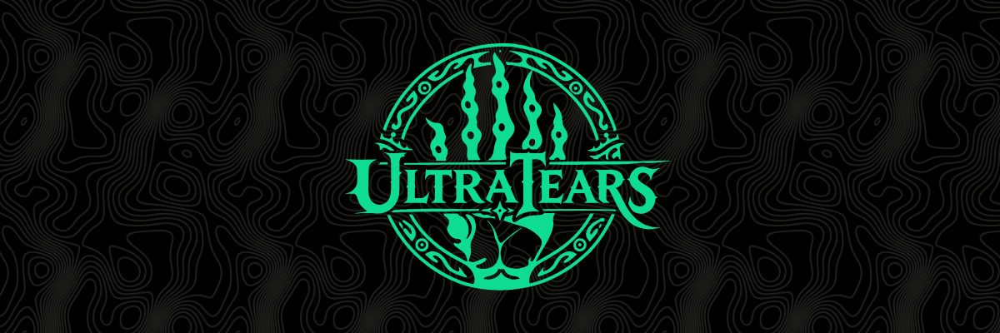

<p align="center"><a href="README.md">English</a> · <b>Русский</b></p>

<p align="center"></p>

# UltraTears

**UltraTears** собирает нативную версию *The Legend of Zelda: Tears of the Kingdom* (версия 1.4.3) для Windows, Linux
и Steam Deck из вашей собственной копии игры. Это не эмулятор: код игры заранее переводится в нативный, а шейдеры и
текстуры готовятся при сборке игры, а не во время игры.

> [!IMPORTANT]
> **Файлов игры здесь нет.** Нужна ваша собственная копия игры с обновлением 1.4.3, снятая с вашей консоли в виде обычных
> папок `exefs` и `romfs`. Проект не даёт файлов игры, ключей, прошивки и инструментов для дампа, а UltraTears ничего
> не расшифровывает. Всё, что делается из игры, делается на вашем ПК и только для вас: не распространяйте это.
>
> UltraTears не связан с Nintendo и не одобрен ею. *The Legend of Zelda* и *Tears of the Kingdom* — товарные знаки
> Nintendo.

О проблемах пишите в [Issues](https://github.com/kuraeow/ultratears/issues) и прикладывайте `ultratears.log` из папки
игры.

## Установка

**Нужно:** Windows 10/11 или Linux (ядро 6.7 и новее, glibc 2.34 и новее; в SteamOS 3 есть оба), видеокарта со свежим
драйвером Vulkan 1.3, 16 ГБ ОЗУ, 4 ГБ видеопамяти, около 40 ГБ свободного места и ваш дамп:

```text
dump\
├── exefs\   main, subsdk0, sdk, main.npdm, ...
└── romfs\   около 304 000 файлов, 16 ГБ
```

### Windows

1. Скачайте `UltraTears-<версия>-windows-x86_64.zip` со страницы [Releases](https://github.com/kuraeow/ultratears/releases)
   и распакуйте в отдельную папку.
2. Запустите `UltraTears Launcher.exe`. Если SmartScreen предупреждает, нажмите **Подробнее → Выполнить в любом случае**.
3. Выберите папку с `exefs` и `romfs` и нажмите **Подготовить игру**. Игра соберётся один раз, примерно за 30 минут.
4. Нажмите **Играть**.

Чтобы играть на Steam Deck, рядом с **Подготовить игру** выберите **Для Linux (Steam Deck)** или **Обе платформы**:
получится `UltraTears-SteamDeck.tar` (около 28 ГБ). Распакуйте его на Deck и запускайте, как ниже, с шага 4.

### Linux и Steam Deck

1. Скачайте `UltraTears.AppImage` со страницы [Releases](https://github.com/kuraeow/ultratears/releases).
   На Steam Deck — в режиме рабочего стола.
2. В свойствах файла на вкладке **Права** включите **Разрешить выполнение файла как программы** и запустите его.
3. Выберите папку с `exefs` и `romfs` и нажмите **Подготовить игру**.
4. Когда подготовка закончится, добавьте `UltraTears.AppImage` из папки игры в Steam как стороннюю игру. Если вписать
   `--play` в параметры запуска, сразу будет запускаться игра, без лаунчера. Запускайте игру из игрового режима.

Новые версии лаунчер находит сам и пересобирает только изменённое; сохранения в `userdata` остаются. На Linux можно
и просто положить новый `UltraTears.AppImage` в папку игры с заменой: лаунчер предложит обновить игру.

<details>
<summary>Управление</summary>

Кнопки геймпада расположены как на Switch (A — правая кнопка); на Steam Deck — как подписаны на самом Deck (A — нижняя
кнопка).

Клавиатура и мышь: WASD — движение, мышь (или стрелки) — камера и прицел, E = A, левый Shift = B, пробел = X,
ЛКМ / T = Y, Q = L, R = R, ПКМ / Z = ZL, F / X = ZR, Esc = + (меню), Tab / M = − (карта), левый Ctrl / C = нажатие
стиков, 1 2 3 4 = крестовина (влево, вверх, вправо, вниз; боковые кнопки мыши — влево и вправо), F11 или Alt+Enter —
полный экран. С зажатой L мышь выбирает способность, с зажатой клавишей крестовины колесо или движение мыши вбок листают
оружие, щиты и материалы. Чувствительность мыши, отдельная для лука и инверсия по вертикали — на странице **Клавиатура**
вкладки **Управление** лаунчера.

На вкладке **Управление** можно переназначить любую кнопку и клавишу (и кнопки мыши) и выбрать раскладку геймпада
(Nintendo: A — правая кнопка; Xbox / Steam Deck: A — нижняя). Подсказки кнопок в игре следуют раскладке и назначениям.
На странице **Стики и гироскоп** задаётся мёртвая зона каждого стика и гироскопа — если стик «дрейфует».
</details>

<details>
<summary>Масштабирование и сглаживание</summary>

На вкладке **Основные** лаунчера:

- **Масштабирование:** сцену можно рисовать в разрешении ниже экранного и увеличивать через **FSR 1** (как в игре) или
  **FSR 3.1** (временной, чётче и стабильнее в движении), или рисовать в полном размере (**Нет**).
- **Сглаживание** (без FSR 3.1, который сглаживает сам): **FXAA** игры, **SMAA** (ровнее края почти без нагрузки на
  видеокарту) или **Выкл**.
</details>

<details>
<summary>Моды и читы</summary>

Моды для эмуляторов Switch подходят как есть. На вкладке **Моды** лаунчера нажмите **Открыть папку модов** и
распакуйте каждый мод в отдельную папку внутри неё так, чтобы его папка `romfs`, `exefs` или `cheats` лежала прямо в
ней (вариант `atmosphere/contents/0100F2C0115B6000/...` тоже подходит). На той же вкладке каждый мод и каждый чит
включается и выключается, а моды упорядочиваются: если два мода меняют один файл, побеждает тот, что выше. Пересобирать
игру для модов и читов не нужно.

- RomFS-моды (текстуры, модели, тексты, ...), патчи ExeFS (`.ips`, `.pchtxt`) и читы Atmosphère (`.txt` с именем по
  build ID игры) для версии игры 1.4.3.
- Патчи и читы, меняющие код игры, готовятся при нажатии **Играть** — несколько секунд, если они изменились. На Linux и
  Steam Deck для этого нужна папка игры, установленная через AppImage; в папке, собранной для Deck на Windows, работают
  только RomFS-моды и читы, меняющие данные.
- Текстура из мода при первой встрече даёт короткий рывок.
</details>

<details>
<summary>Китайский и корейский текст</summary>

Для упрощённого и традиционного китайского и для корейского игра использует системные шрифты Switch. Они входят в
системное ПО консоли, а не в игру, поэтому из дампа их не сделать. Без них игра останавливается при запуске на одном из
этих языков; остальным языкам они не нужны.

Положите файлы общих шрифтов консоли, взятые с вашей Switch, в `sysdata\fonts\` рядом с `exefs` и `romfs` в папке
дампа до **Подготовить игру** (или позже прямо в `data\fonts\` в папке игры):

```text
dump\
└── sysdata\fonts\   0-standard.bfttf, 1-chinese-simplified.bfttf, 2-chinese-simplified-extension.bfttf,
                     3-chinese-traditional.bfttf, 4-korean.bfttf, 5-nintendo-extension.bfttf
```

Положите все шесть; игра читает только те, что ей нужны.
</details>

## Сборка из исходников

Установите Git и Python 3, затем:

```powershell
git clone https://github.com/kuraeow/ultratears.git
cd ultratears
python tools/setup.py --dump D:\путь\к\дампу
```

Сборщик сам скачает недостающие инструменты и соберёт в папке `build\` готовую игру с лаунчером, как в релизе.
Запускайте `build\UltraTears Launcher.exe`. Без `--dump` дамп берётся из папки `dump\` в репозитории. Параметры, Linux и устройство сборки: [BUILDING.md](BUILDING.md). Как
предложить изменения: [CONTRIBUTING.md](CONTRIBUTING.md).

## Правовое

- В репозитории и в релизах нет ничего из игры: ни кода (в том числе переведённого из неё), ни ресурсов, шейдеров,
  текстур, шрифтов, ключей или прошивки. Всё это делается из вашего дампа на вашем ПК.
- Код и заголовки Nintendo SDK не используются: системный и графический слои — собственные.
- В исходниках только факты, нужные для запуска: адреса, хеши, короткие замены инструкций.
- Название, эмблема, иконка и обложка — собственные работы автора и не под GPL: [assets/BRANDING.md](assets/BRANDING.md).
  Сторонний код: [third_party/README.md](third_party/README.md).
