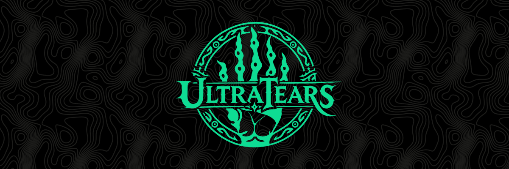

<p align="center"><a href="README.md">English</a> · <a href="README.ru.md">Русский</a> · <b>Türkçe</b></p>

<p align="center"></p>

<p align="center">
  <a href="https://github.com/kuraeow/ultratears/releases/latest"><b>En son sürümü indir</b></a> ·
  <a href="https://x.com/kuraeow">X (@kuraeow)</a>
</p>

<p align="center">
  <a></a>
  <a href="https://github.com/kuraeow/ultratears/releases"></a>
  <a href="https://github.com/kuraeow/ultratears/releases/latest"></a>
</p>

# UltraTears

**UltraTears**, kendi oyun kopyanızdan Windows, Linux ve Steam Deck için *The Legend of Zelda: Tears of the Kingdom* (sürüm 1.4.3) oyununun yerel (native) bir sürümünü derler. Bir emülatör değildir: oyunun kodu önceden yerel koda çevrilir; gölgelendiricileri (shader) ve dokuları siz oynarken değil, oyun derlenirken hazırlanır.

> [!IMPORTANT]
> **Hiçbir oyun dosyası dahil değildir.** Kendi konsolunuzdan düz `exefs` ve `romfs` klasörleri olarak dökülmüş (dump), 1.4.3 güncellemeli kendi oyun kopyanıza ihtiyacınız vardır. Bu proje hiçbir oyun dosyası, anahtar, bellenim (firmware) veya döküm aracı sağlamaz ve UltraTears hiçbir şifre çözme işlemi yapmaz. Oyundan üretilen her şey kendi bilgisayarınızda, yalnızca kişisel kullanımınız için oluşturulur: paylaşmayın.
>
> UltraTears'ın Nintendo ile herhangi bir bağlantısı veya onayı yoktur. *The Legend of Zelda* ve *Tears of the Kingdom*, Nintendo'nun ticari markalarıdır.

Sorunları oyun klasöründeki `ultratears.log` dosyasıyla birlikte [Issues](https://github.com/kuraeow/ultratears/issues) üzerinden bildirin.

## Kurulum

**Gereksinimler:** Windows 10/11 veya Linux (çekirdek 6.7+, glibc 2.34+; SteamOS 3 her ikisini de içerir), güncel bir Vulkan 1.3 sürücüsüne sahip ekran kartı, 16 GB RAM, 4 GB video belleği, yaklaşık 40 GB boş alan ve oyun dökümünüz:

```text
dump\
├── exefs\   main, subsdk0, sdk, main.npdm, ...
└── romfs\   yaklaşık 304.000 dosya, 16 GB
```

### Windows

1. [Releases](https://github.com/kuraeow/ultratears/releases) sayfasından `UltraTears-<version>-windows-x86_64.zip` dosyasını indirin ve kendi klasörüne çıkarın.
2. `UltraTears Launcher.exe` dosyasını başlatın. SmartScreen uyarı verirse **Ek bilgi → Yine de çalıştır** seçeneğini seçin.
3. `exefs` ve `romfs` klasörlerini içeren dizini seçin ve **Prepare the game** düğmesine tıklayın. Oyun bir kez derlenir, bu işlem yaklaşık 30 dakika sürer.
4. **Play** düğmesine tıklayın.

Steam Deck üzerinde oynamak için **Prepare the game** yanından **For Linux (Steam Deck)** veya **Both platforms** seçeneğini işaretleyin: yaklaşık 28 GB boyutunda `UltraTears-SteamDeck.tar` dosyası oluşur; bunu Deck'e çıkarıp aşağıdaki 4. adımdan itibaren başlatabilirsiniz.

### Linux ve Steam Deck

1. [Releases](https://github.com/kuraeow/ultratears/releases) sayfasından `UltraTears.AppImage` dosyasını indirin. Steam Deck'te bunu Masaüstü Modu'nda (Desktop Mode) yapın.
2. Dosyanın Özellikler penceresindeki **İzinler (Permissions)** sekmesinde **Dosyayı program olarak çalıştırmaya izin ver** seçeneğini açın, ardından başlatın.
3. `exefs` ve `romfs` klasörlerini içeren dizini seçin ve **Prepare the game** düğmesine tıklayın.
4. Oyun hazırlandığında, oyun klasöründeki `UltraTears.AppImage` dosyasını Steam'e Steam dışı oyun olarak ekleyin. Başlatma seçeneklerine `--play` eklerseniz oyun başlatıcıyı açmadan doğrudan başlar. Oyunu Oyun Modu'ndan (Gaming Mode) başlatın.

Başlatıcı yeni sürümleri kendisi bulur ve yalnızca değişen kısımları yeniden derler; `userdata` içindeki kayıtlarınız korunur. Linux'ta ayrıca oyun klasöründeki eski `UltraTears.AppImage` dosyasının yerine daha yenisini koyabilirsiniz; başlatıcı bu durumda güncellemeyi önerir.

<details>
<summary>Kontroller</summary>

Oyun kumandası düğme düzeni Switch'i izler (A sağdaki düğmedir); Steam Deck'te ise Deck'in kendi etiketlerini izler (A alttaki düğmedir).

Klavye ve fare: WASD hareket, fare (veya ok tuşları) kamerayı çevirir ve nişan alır, E = A, Sol Shift = B, Boşluk = X, sol tık / T = Y, Q = L, R = R, sağ tık / Z = ZL, F / X = ZR, Esc = + (menü), Tab / M = − (harita), Sol Ctrl / C = analog çubuk düğmeleri, 1 2 3 4 = yön tuşları (sol, yukarı, sağ, aşağı; farenin yan düğmeleri sol ve sağdır), F11 veya Alt+Enter tam ekran. L tuşunu basılı tutarken fare bir yetenek seçer; bir yön tuşunu basılı tutarken fare tekerleği veya fareyi yana hareket ettirmek silahlar, kalkanlar ve malzemeler arasında geçiş yapar. Fare hassasiyeti, yay hassasiyeti ve ters yukarı-aşağı ayarları başlatıcının **Controls** sekmesindeki **Keyboard** sayfasındadır.

Her ikisi de başlatıcının **Controls** sekmesinde değiştirilebilir: her düğme ve tuş (fare düğmeleri dahil) ve kumanda düzeni (Nintendo: A sağdaki düğmedir; Xbox / Steam Deck: A alttakidir). Oyundaki düğme ipuçları sizin düzeninizi ve atamalarınızı izler. **Sticks and gyro** sayfası, kayma (drift) yapan bir çubuk için her çubuğun ve jiroskopun ölü bölgesini ayarlar.
</details>

<details>
<summary>Ölçekleme ve kenar yumuşatma</summary>

Başlatıcının **General** sekmesinde:

- **Scene scale:** Sahne, ekran çözünürlüğünün altında çizilip **FSR 1** (oyunun kendi sistemi) veya **FSR 3.1** (zamansal, hareket hâlinde daha keskin ve kararlı) ile ölçeklenebilir ya da tam boyutta (**None**) çizilebilir.
- **Anti-aliasing** (kendi başına kenar yumuşatma yapan FSR 3.1 kullanılmadığında): oyunun **FXAA**'sı, **SMAA** (düşük GPU maliyetiyle daha pürüzsüz kenarlar) veya **Off**.
</details>

<details>
<summary>Modlar ve hileler</summary>

Switch emülatörleri için yapılan modlar olduğu gibi çalışır. Başlatıcının **Mods** sekmesinde **Open mods folder** düğmesine tıklayın ve her modu kendi klasörüne çıkarın; böylece `romfs`, `exefs` veya `cheats` klasörü doğrudan o klasörün içinde yer alır (`atmosphere/contents/0100F2C0115B6000/...` yapısı da çalışır). Aynı sekmeden her modu ve hileyi açıp kapatabilir, mod sıralamasını belirleyebilirsiniz: iki mod aynı dosyayı değiştiriyorsa listede daha yukarıda olan kazanır. Modlar ve hileler oyunun yeniden derlenmesini gerektirmez.

- 1.4.3 oyun sürümü için RomFS modları (dokular, modeller, metinler...), ExeFS yamaları (`.ips`, `.pchtxt`) ve Atmosphere hileleri (oyunun derleme kimliğiyle adlandırılmış `.txt`).
- Oyunun kodunu değiştiren yamalar ve hileler **Play** tuşuna bastığınızda hazırlanır; değişiklik olduğunda birkaç saniye sürer. Linux ve Steam Deck'te bunun için oyun klasörünün AppImage tarafından kurulmuş olması gerekir; Deck için Windows'ta oluşturulan bir klasörde yalnızca RomFS modları ve veri değiştiren hileler çalışır.
- Bir moddan gelen doku ilk kez görüldüğünde kısa bir takılmaya neden olabilir.
</details>

<details>
<summary>Çince ve Korece metinler</summary>

Basitleştirilmiş Çince, Geleneksel Çince ve Korece için oyun Switch'in kendi sistem yazı tiplerini kullanır. Bunlar oyunun değil konsolun sistem yazılımının parçası olduğundan, port bunları dökümden üretemez. Bu yazı tipleri olmadan oyun bu dillerden birinde başlatıldığında durur; diğer tüm diller bunlara ihtiyaç duymaz.

Kendi Switch konsolunuzdan aldığınız paylaşımlı yazı tipi dosyalarını **Prepare the game** öncesinde döküm klasörünüzde `exefs` ve `romfs` yanındaki `sysdata\fonts\` dizinine (veya daha sonra doğrudan oyun klasöründeki `data\fonts\` dizinine) koyun:

```text
dump\
└── sysdata\fonts\   0-standard.bfttf, 1-chinese-simplified.bfttf, 2-chinese-simplified-extension.bfttf,
                     3-chinese-traditional.bfttf, 4-korean.bfttf, 5-nintendo-extension.bfttf
```

Altısını da koyun; oyun yalnızca istediklerini okur.
</details>

## Kaynak koddan derleme

Git ve Python 3 kurun, ardından:

```powershell
git clone https://github.com/kuraeow/ultratears.git
cd ultratears
python tools/setup.py --dump D:\path\to\dump
```

Kurulum betiği eksik araçları indirir ve tıpkı bir sürüm paketinde olduğu gibi başlatıcı dahil eksiksiz oyun klasörünü `build\` içinde oluşturur. `build\UltraTears Launcher.exe` dosyasını başlatın. `--dump` verilmezse depodaki `dump\` klasörünü kullanır. Seçenekler, Linux ve çalışma biçimi için: [BUILDING.md](BUILDING.md).
Katkıda bulunma: [CONTRIBUTING.md](CONTRIBUTING.md).

## Yasal bilgilendirme

- Bu depoda veya sürümlerde oyuna ait hiçbir şey bulunmaz: kod (ondan çevrilmiş kod dahil), varlıklar, gölgelendiriciler, dokular, yazı tipleri, anahtarlar veya bellenim yoktur. Bunların tamamı kendi bilgisayarınızda dökümünüzden üretilir.
- Hiçbir Nintendo SDK kodu veya başlık dosyası kullanılmaz: sistem ve grafik katmanları UltraTears'ın kendi kodudur.
- Kaynak kod yalnızca oyunu çalıştırmak için gereken olguları içerir: adresler, özetler (hash) ve kısa komut değişiklikleri.
- Ad, amblem, simge ve kapak görseli geliştiricinin kendi eseridir ve GPL kapsamında değildir: [assets/BRANDING.md](assets/BRANDING.md). Üçüncü taraf kodlar: [third_party/README.md](third_party/README.md).
